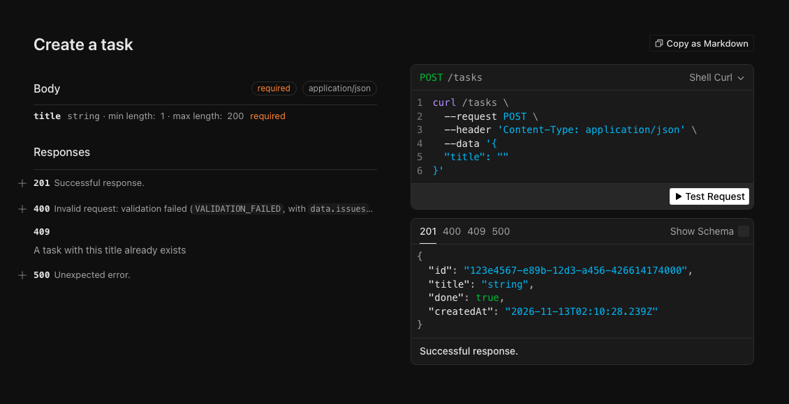

# Dotpress

[](https://www.npmjs.com/package/@dotpress/core)
[](https://github.com/dotpressjs/dotpress/actions/workflows/ci.yml)
[](LICENSE)

A lightweight, decorator-free TypeScript framework for building end-to-end typed backend APIs, on the HTTP server you choose.

> 🚧 Dotpress V2 is in beta (`2.0.0-beta`): the API is complete, and changes before 2.0.0 only from feedback. Install the packages without tag, except `@dotpress/auth@beta` (without tag, `@dotpress/auth` is the 1.x).

**[Documentation](https://dotpress.dev)** · **[Getting started](https://dotpress.dev/getting-started/introduction)** · **[Examples](examples)**

## Why Dotpress

Express, Fastify and Hono serve HTTP very well. What an API needs on top of them is always the same: validated and typed inputs, a consistent error format, middlewares, documentation. Built by hand, that layer ends up different in every project, and coupled to its server.

Dotpress provides it, once:

- **Typed from your schemas.** Zod schemas validate the params, the query, the body and the response of each route, and type them in the handler. No type to declare twice.
- **Errors are returned.** A handler returns `notFoundError()` like any other value. Every error, from a failed validation to an unexpected exception, has the same JSON format.
- **Any HTTP server.** The same routes run on Express, Fastify, Hono and AWS Lambda.
- **No decorators, no DI.** Plain functions and objects, readable and testable.
- **Packages when you need them.** Authentication, OpenAPI, emails, events, cache and testing helpers.

## Before and after

A route that creates a task in a project, with Express alone:

```ts
const TaskInput = z.object({ title: z.string().min(1), dueOn: z.iso.date().optional() })

app.post('/projects/:projectId/tasks', express.json(), async (req, res, next) => {
  try {
    const input = TaskInput.safeParse(req.body) // req.body: any
    if (!input.success) {
      res.status(400).json({ errors: input.error.issues }) // a format of your own
      return
    }
    const project = await findProject(req.params.projectId)
    if (!project) {
      res.status(404).json({ message: 'Project not found' })
      return
    }
    res.status(201).json(await createTask(project.id, input.data)) // the response is not checked
  } catch (error) {
    next(error) // Express 4 loses the errors of async handlers without it
  }
})
```

With Dotpress:

```ts
defineRoute({
  method: 'post',
  path: '/projects/:projectId/tasks',
  status: 201,
  schema: (z) => ({
    body: z.object({ title: z.string().min(1), dueOn: z.iso.date().optional() }),
    response: Task,
  }),
  meta: { summary: 'Create a task', responses: { 404: 'Project not found' } },
  handler: async ({ req }) => {
    const project = await findProject(req.params.projectId) // projectId: string, from the path
    if (!project) return notFoundError('Project not found')
    return createTask(project.id, req.body) // body: { title: string; dueOn?: string }
  },
})

const app = await createApp({
  adapter: expressAdapter(), // or fastifyAdapter(), honoAdapter()
  plugins: [openapiPlugin({ info: { title: 'Tasks API', version: '1.0.0' } })],
})
await app.listen(3000)
```

- the body is validated before the handler, and typed from its schema;
- an invalid request gets a `400 VALIDATION_FAILED` listing every issue, in the format of every other error;
- the response is checked against its schema;
- errors, thrown or returned, never escape: an unexpected one is a `500`, logged and reported to `onError`;
- the route is documented: `/openapi.json` and `/docs` come from the same declaration.

## Generated documentation

`@dotpress/openapi` builds the OpenAPI 3.1 document from the routes, and serves a [Scalar](https://scalar.com) API reference. From the [Express example](examples/express):



## Quick start

Requires Node.js 22.12 or later.

```sh
npm install @dotpress/core @dotpress/adapter-express express zod
```

Then follow [Getting started](https://dotpress.dev/getting-started/introduction), or copy an example:

```sh
npx degit dotpressjs/dotpress/examples/express my-api
```

## Packages

| Package | Description | Version |
|---|---|---|
| [`@dotpress/core`](packages/core) | Server-agnostic core: routing, validation, pipeline, responses | 2.0 beta |
| [`@dotpress/adapter-express`](packages/adapter-express) | Express 4 and 5 adapter | 2.0 beta |
| [`@dotpress/adapter-hono`](packages/adapter-hono) | Hono 4 adapter, on Node.js and AWS Lambda | 2.0 beta |
| [`@dotpress/adapter-fastify`](packages/adapter-fastify) | Fastify 5 adapter, on Node.js and AWS Lambda | 2.0 beta |
| [`@dotpress/testing`](packages/testing) | Testing helpers and adapter conformance suite | 2.0 beta |
| [`@dotpress/auth`](packages/auth) | JWT authentication plugin | 2.0 beta |
| [`@dotpress/openapi`](packages/openapi) | OpenAPI 3.1 documents and Scalar API reference | 2.0 beta |
| [`@dotpress/mailer`](packages/mailer) | Typed, multilingual email templates (MJML or HTML) | 2.0 beta |
| [`@dotpress/events`](packages/events) | Typed events and listeners, run by workers through interchangeable transports | 2.0 beta |
| [`@dotpress/cache`](packages/cache) | Request memoization with batching, and a resilient cache with interchangeable stores | 2.0 beta |

The V1 framework (`dotpress` on npm) is frozen in 1.x. To upgrade, see [Migrate from v1](https://dotpress.dev/reference/migrate-from-v1).

## Examples

Runnable apps, tested by the CI: one per server ([Express](examples/express), [Fastify](examples/fastify), [Hono](examples/hono)), one per feature ([auth](examples/auth), [events](examples/events), [mailer](examples/mailer), [cache](examples/cache)), and a [Tasks API](examples/tasks-api) that assembles every package. See [examples](examples).

## Contributing

Contributions are welcome: see [CONTRIBUTING.md](CONTRIBUTING.md) for the setup, the checks and the changesets, and the [code of conduct](CODE_OF_CONDUCT.md). Report vulnerabilities privately, as described in the [security policy](SECURITY.md).

## License

[MIT](LICENSE)
